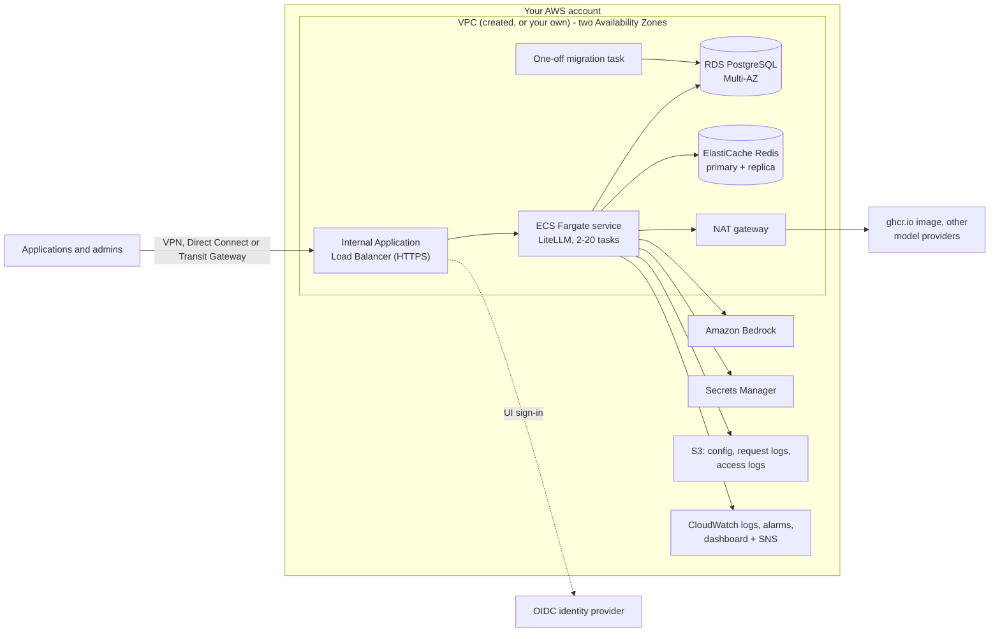

# Guidance for Multi-Provider Generative AI Gateway on AWS

This Guidance runs the open-source [LiteLLM](https://docs.litellm.ai/) proxy (MIT License; its `enterprise/`
directory is under a separate licence) as a private gateway, designed for high availability, in your AWS account,
deployed with Terraform. Applications call one OpenAI-compatible endpoint; LiteLLM routes the calls to Amazon
Bedrock and other model providers, and handles virtual API keys, teams, budgets, rate limits, spend tracking and
its admin UI.

## Table of contents

- [Project Overview](#project-overview)
- [Architecture](#architecture)
- [AWS Services in this Guidance](#aws-services-in-this-guidance)
- [Deployment Options](#deployment-options)
- [Cost](#cost)
  - [Cost Considerations](#cost-considerations)
  - [Cost Components](#cost-components)
  - [Deployed Components](#deployed-components)
  - [Key Factors Influencing AWS Infrastructure Costs](#key-factors-influencing-aws-infrastructure-costs)
  - [Customer Responsibility](#customer-responsibility)
- [Security](#security)
- [Repository structure](#repository-structure)
- [Open source libraries](#open-source-libraries)
- [Notices](#notices)

## Project Overview

The Guidance hosts the official, unmodified LiteLLM container image. It adds no code to the request path; it
provides the AWS infrastructure, security-focused defaults and deployment scripts around it. Everything LiteLLM itself does
(models, keys, teams, budgets, guardrails, SSO) is described in the [LiteLLM documentation](https://docs.litellm.ai/).

The foundation creates an empty AWS CloudFormation stack (`<deployment_name>-tracking-stack`) whose description
carries the Guidance's solution ID; AWS uses it to count deployments of this Guidance.

## Architecture

The diagram shows the default private deployment, the recommended configuration. The other
[deployment options](#deployment-options) are described in [docs/deployment.md](docs/deployment.md).

1. Clients reach an internal Application Load Balancer, admitted from the VPC and the client ranges or security
   groups you list.
2. HTTPS terminates on the load balancer with your AWS Certificate Manager (ACM) certificate. The load balancer
   requires OIDC sign-in in front of the LiteLLM UI paths; API paths use LiteLLM virtual keys.
3. LiteLLM runs on Amazon ECS on AWS Fargate (Graviton, two tasks minimum across two Availability Zones, CPU and
   memory target-tracking scaling up to 20 tasks). When the image or the task configuration changes, the apply first
   runs the database schema migration as a one-off task; the service only rolls if it succeeds, and the deployment circuit breaker rolls back a failed
   rollout. The container health check also fails when the task's memory, without reclaimable page cache, stays
   at 90 % of the task memory for about five minutes; ECS then starts a replacement before it stops and drains
   the task, because LiteLLM can hold on to memory it no longer uses.
4. Amazon RDS for PostgreSQL stores keys, teams, budgets, spend and models added through the UI or API. Amazon
   ElastiCache (Redis OSS) holds shared rate-limit and routing state and the response cache.
5. Generated credentials (master key, salt key, UI password, database URL, Redis token) live only in AWS Secrets
   Manager and reach the tasks as secret references; the Guidance is designed to keep them out of Terraform
   variables and state.
6. Terraform renders the LiteLLM configuration and stores it in Amazon S3; request metadata (not prompts or
   responses) is logged to S3; Amazon CloudWatch holds logs, alarms and a dashboard, with alarm notifications
   through Amazon SNS.
7. LiteLLM calls Amazon Bedrock with its task role. Pulling the image from ghcr.io, other model providers and the
   identity provider need outbound internet access through the NAT gateway (or your own egress). Signed LiteLLM
   licence keys are verified offline.

## AWS Services in this Guidance

| AWS service | Use in this Guidance |
| --- | --- |
| [Amazon Bedrock](https://aws.amazon.com/bedrock/) | Foundation models that LiteLLM calls with its task role. |
| [Amazon Elastic Container Service (ECS)](https://aws.amazon.com/ecs/) on [AWS Fargate](https://aws.amazon.com/fargate/) | Runs the LiteLLM containers and the schema migration task. |
| [Elastic Load Balancing (Application Load Balancer)](https://aws.amazon.com/elasticloadbalancing/application-load-balancer/) | Entry point that terminates HTTPS and enforces UI sign-in. |
| [Amazon Virtual Private Cloud (VPC)](https://aws.amazon.com/vpc/) | Isolated network with private subnets, NAT gateway, VPC endpoints and flow logs. |
| [Amazon Relational Database Service (RDS)](https://aws.amazon.com/rds/) | PostgreSQL database for LiteLLM keys, teams, budgets, spend and models. |
| [Amazon ElastiCache](https://aws.amazon.com/elasticache/) | Redis OSS for shared rate-limit, routing and cache state. |
| [AWS Secrets Manager](https://aws.amazon.com/secrets-manager/) | Stores generated credentials and the secrets you provide. |
| [Amazon Simple Storage Service (S3)](https://aws.amazon.com/s3/) | Holds the rendered LiteLLM configuration, request logs and load balancer access logs. |
| [Amazon CloudWatch](https://aws.amazon.com/cloudwatch/) | Logs, metrics, alarms and the gateway dashboard. |
| [Amazon Simple Notification Service (SNS)](https://aws.amazon.com/sns/) | Delivers alarm notifications. |
| [AWS Identity and Access Management (IAM)](https://aws.amazon.com/iam/) | Least-privilege roles for the tasks, monitoring and flow logs. |
| [AWS Key Management Service (KMS)](https://aws.amazon.com/kms/) | Encryption keys for the data stores, logs and alarm topic. |
| [AWS Certificate Manager (ACM)](https://aws.amazon.com/certificate-manager/) | TLS certificate for the load balancer. |
| [Amazon Route 53](https://aws.amazon.com/route53/) | Optional DNS alias record for the gateway. |
| [AWS WAF](https://aws.amazon.com/waf/) | Helps protect the load balancer in public mode. |
| [AWS Client VPN](https://aws.amazon.com/vpn/client-vpn/) | Optional demo access path for trial deployments. |
| [Amazon Elastic Container Registry (ECR)](https://aws.amazon.com/ecr/) | Optional private copy of the LiteLLM image for deployments without internet access. |
| [AWS CloudFormation](https://aws.amazon.com/cloudformation/) | Empty stack that counts deployments of this Guidance. |

## Deployment Options

The gateway deploys as a trial (private, plain HTTP, demo VPN; for testing only), as the recommended
private deployment with HTTPS, DNS, an identity provider and a LiteLLM licence, or in public mode behind AWS
WAF. Follow [docs/deployment.md](docs/deployment.md); every input and output is listed in
[docs/configuration.md](docs/configuration.md).

## Cost

### Cost Considerations

When implementing this Guidance on AWS, it is important to understand the factors that contribute to the overall
cost. This section outlines the main cost components and the factors that influence them. Estimate the cost of
your configuration in your Region with the [AWS Pricing Calculator](https://calculator.aws/).

### Cost Components

The total cost of running this Guidance falls into two components:

1. **Model provider costs**: charges for Amazon Bedrock and any other model provider the gateway calls, typically
   based on the number of tokens processed, the model, and usage volume. The LiteLLM Enterprise licence, if you
   use one, is billed by its vendor.
2. **AWS infrastructure costs**: the AWS resources that host and operate the gateway, listed below.

### Deployed Components

A default deployment runs these resources around the clock:

| AWS service | Resources |
| --- | --- |
| Amazon VPC | 1 NAT gateway with 1 public IPv4 address; the S3 gateway endpoint (no charge) |
| Elastic Load Balancing | 1 Application Load Balancer |
| Amazon ECS on AWS Fargate | 2 or more tasks (Linux/ARM, 2 vCPU, 4 GiB memory each) |
| Amazon RDS for PostgreSQL | 1 `db.t4g.large` instance, Multi-AZ, gp3 storage from 20 GB, 30 days of backups |
| Amazon ElastiCache (Redis OSS) | 2 `cache.t3.micro` nodes |
| AWS Secrets Manager | 5 generated secrets, plus each secret you add (identity provider, licence, provider API keys) |
| Amazon CloudWatch | Log groups with ten-year retention, alarms, 1 dashboard, Container Insights |
| Amazon S3 | Config, request-log and access-log buckets |
| AWS KMS | 1 key for the alarm topic (replaced by your key when `kms_key_arn` is set) |
| AWS Certificate Manager | Your certificate (public certificates have no charge) |

Optional components add to this:

| AWS service | When |
| --- | --- |
| Interface VPC endpoints | `create_interface_endpoints` or `disable_outbound_network_access`: 6 endpoints, each billed per Availability Zone |
| AWS WAF and public IPv4 addresses | Public mode: 1 web ACL with 4 rules, and public addresses for the internet-facing load balancer |
| AWS Client VPN | Trial deployments with `create_vpn`: 1 subnet association, plus each connected client |
| Amazon Route 53 | A hosted zone for `record_name`, if you do not have one |
| Amazon ECR | A mirrored copy of the LiteLLM image |
| AWS Private Certificate Authority | A private CA, if your certificate is for a private name |

### Key Factors Influencing AWS Infrastructure Costs

The actual cost depends on your configuration and usage patterns. The main factors are:

1. **Compute**: the number of Fargate tasks. The service scales out under load (see
   [Architecture](#architecture)), so sustained traffic adds tasks.
2. **Database storage**: grows with keys, teams, users, budgets and per-request spend records.
3. **Traffic patterns**: request and response sizes, requests and tokens per minute, concurrency, and the latency
   of the model providers, which keeps connections and tasks busy.
4. **Logging**: CloudWatch log ingestion and storage; with ten-year retention, storage grows every month. DEBUG
   logging multiplies the volume.
5. **Networking**: NAT gateway data processing for calls to non-Bedrock providers, data transfer, and interface
   endpoint data processing.
6. **Load balancer and WAF requests**: capacity units and, in public mode, WAF requests.

This is not an exhaustive list, but it covers the main contributors.

### Customer Responsibility

While this Guidance provides default configurations, customers are responsible for:

1. Configuring the Guidance for their use case and requirements.
2. Monitoring and managing the costs of the AWS infrastructure.
3. Managing and optimising the costs of their chosen model providers.

We recommend creating a [budget](https://docs.aws.amazon.com/cost-management/latest/userguide/budgets-create.html)
in [AWS Cost Explorer](https://aws.amazon.com/aws-cost-management/aws-cost-explorer/) to help manage costs. Prices
are subject to change; see the pricing page of each AWS service for full details.

## Security

When you build systems on AWS infrastructure, security responsibilities are shared between you and AWS. This
[shared responsibility model](https://aws.amazon.com/compliance/shared-responsibility-model/) reduces your
operational burden because AWS operates, manages, and controls the components including the host operating
system, the virtualization layer, and the physical security of the facilities in which the services operate. For
more information about AWS security, visit [AWS Cloud Security](https://aws.amazon.com/security/).

Weakening a default (public mode, plain HTTP, DEBUG logging) takes an explicit input; public mode without an
identity provider and DEBUG logging also print a warning on every plan.

### Identity and Access Management (IAM)

- **Task role**: may invoke Amazon Bedrock models and guardrails, read the LiteLLM configuration and write request
  logs. Inputs narrow the allowed models and Regions, and other accounts' roles can only be assumed when listed
  explicitly.
- **Execution role**: reads only the secrets the tasks use and writes their logs; it gets image pull rights only
  for a private ECR repository given as `image_uri`.
- **Service roles**: RDS Enhanced Monitoring and VPC flow logs each have their own role. No policy grants `*`
  actions.

### Network Security

- **Amazon VPC**: the tasks, database and cache run in private subnets in two Availability Zones, in a VPC the
  Guidance creates or one you bring.
- **Internal load balancer**: reachable only from the VPC and the client ranges or security groups you list;
  public mode is opt-in and attaches AWS WAF.
- **Security groups**: traffic is allowed only from the load balancer to the tasks and from the tasks (and clients
  you list) to the database and cache.
- **Egress**: one NAT gateway serves outbound calls; a mode without internet access uses VPC endpoints only.
- **VPC flow logs**: in a created VPC, all traffic is logged to CloudWatch Logs; a bring-your-own VPC keeps its
  own flow log configuration.

### Data Protection

- **In transit**: the load balancer serves HTTPS with a TLS 1.2/1.3 policy and redirects HTTP; Redis requires TLS
  and an auth token.
- **At rest**: RDS, ElastiCache, Secrets Manager, CloudWatch Logs and the S3 buckets are encrypted, with AWS
  managed keys or your own AWS KMS key; the alarm topic is encrypted with a KMS key the Guidance creates, or with
  your own key.
- **S3 buckets**: public access blocked and TLS-only bucket policies.
- **Prompts and responses**: kept out of LiteLLM's logging callbacks; the request logs in S3 hold metadata only.
  Email addresses are masked in the LiteLLM log group, and database logs omit query parameter values.
- **Backups**: deletion protection is on by default, automated backups are kept for 30 days, and destroying the
  database takes a final snapshot.

### Monitoring and Logging

- **Amazon CloudWatch**: alarms on load balancer, ECS, RDS and ElastiCache metrics and on LiteLLM errors, a
  dashboard, and an encrypted SNS topic for notifications.
- **Logs**: the container, RDS PostgreSQL, VPC flow, WAF and Client VPN log groups, and the load balancer access
  logs and request logs in S3, are retained for ten years.

### Container Security

- **Pinned image**: the official LiteLLM image is pinned by digest, so tasks run the reviewed image even if its
  tag is re-pushed.
- **Mirroring**: `deploy/mirror-image.sh` copies the pinned digest by default and verifies the upstream image
  signature before copying it into Amazon ECR.

### Secrets Management

- **AWS Secrets Manager**: credentials are generated at the first deployment and written with Terraform
  write-only arguments, which are designed to keep them out of Terraform variables, plans and state. Secrets you add are passed as
  Secrets Manager ARNs; only the identity provider client secret reaches the Terraform state (see
  [Identity provider](docs/deployment.md#identity-provider)).

### Additional Security Considerations

- Keep the LiteLLM image up to date; follow the [LiteLLM release notes](https://docs.litellm.ai/release_notes).
- Give applications LiteLLM virtual keys with budgets and rate limits; keep the master key for administration.
- Configure an identity provider, especially in public mode.
- Review IAM permissions, client ranges and LiteLLM users and teams regularly.

## Repository structure

| Path | Contents |
| --- | --- |
| [`terraform/foundation`](terraform/foundation) | Long-lived network and data: VPC, RDS, Redis, Secrets Manager, config bucket, optional demo Client VPN. |
| [`terraform/app`](terraform/app) | Load balancer, WAF, ECS service and migration task, LiteLLM configuration, IAM, logs, alarms. |
| [`terraform/modules`](terraform/modules/README.md) | Child modules: observability, rollout and vpn. |
| [`deploy`](deploy) | Deployment scripts and the `terraform.tfvars.example` input file. |
| [`docs`](docs) | [Deployment guide](docs/deployment.md) and [configuration reference](docs/configuration.md). |
| [`examples/agentcore`](examples/agentcore/README.md) | An agent on Amazon Bedrock AgentCore Runtime that does all of its inference through the gateway. |
| [`examples/eks`](examples/eks/README.md) | Guidance for running the gateway on Amazon EKS on top of the foundation stack (not a tested deployment). |
| [`loadtest`](loadtest/README.md) | Load-test harness for a deployed gateway. |

## Open source libraries

For the open source libraries this Guidance uses, see [ATTRIBUTION](ATTRIBUTION.md).

## Notices

Customers are responsible for making their own independent assessment of the information in this Guidance. This
Guidance: (a) is for informational purposes only, (b) represents AWS current product offerings and practices,
which are subject to change without notice, and (c) does not create any commitments or assurances from AWS and its
affiliates, suppliers or licensors. AWS products or services are provided "as is" without warranties,
representations, or conditions of any kind, whether express or implied. AWS responsibilities and liabilities to its
customers are controlled by AWS agreements, and this Guidance is not part of, nor does it modify, any agreement
between AWS and its customers.
